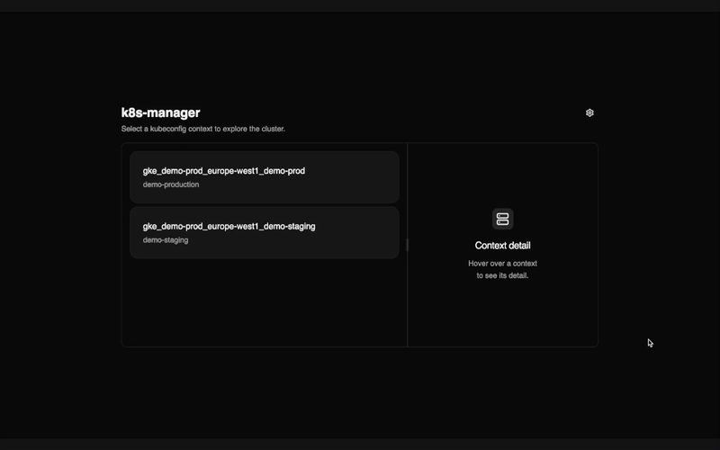

# k8s-manager



*([full-quality video](docs/demo.mp4))*

A read-only observability tool for Kubernetes clusters. It gives you a fast web UI to browse everything running in a cluster — Deployments, Services, Pods, StatefulSets, DaemonSets, Jobs/CronJobs, Ingresses, ConfigMaps/Secrets, PVs/PVCs, Nodes, CRDs, Helm releases, HPAs, Namespaces, NetworkPolicies, Endpoints and PodDisruptionBudgets — without ever creating, modifying, or deleting anything in the cluster.

## Features

- **Context switching** — pick any context from your kubeconfig and browse its resources.
- **Resource navigation** — Deployments → Services → Pods and every other resource kind, with relationships resolved between them (which Pods back a Service, which PVC is bound to which PV, etc.).
- **Describe panel** — click any resource to inspect it instantly, including raw YAML with copy-to-clipboard.
- **Command palette** (Cmd/Ctrl+K) — jump to any loaded resource by name.
- **Cluster dashboard** — overview of cluster health (non-Running pods, not-ready deployments, issues detected).
- **Cluster events** — `kubectl get events`-style view, filterable by namespace/resource.
- **Pod logs** — snapshot of recent logs with manual refresh, and log download.
- **Metrics** — CPU/RAM usage for pods and nodes, with a short in-memory history chart.
- **Namespace filter, pinned resources, sortable tables** for faster day-to-day inspection.
- Secrets are always shown redacted; the app has no write access to the cluster at all.

## Requirements

- Node.js 20+
- A working kubeconfig with access to the cluster(s) you want to inspect (`~/.kube/config` on macOS/Linux, `%USERPROFILE%\.kube\config` on Windows, or set `KUBECONFIG` to a custom path).

## Desktop app

Prebuilt desktop apps for macOS (Apple Silicon and Intel), Windows and Linux are attached to every [GitHub release](https://github.com/EsteveSegura/k8s-manager/releases). They bundle the UI and the API server, so you only need a working kubeconfig (plus any auth plugins it uses, such as `gke-gcloud-auth-plugin`, on your `PATH`).

The builds are not code-signed yet:

- **macOS**: if it says the app is damaged or can't be opened, run `xattr -cr /Applications/k8s-manager.app` once after installing it.
- **Windows**: SmartScreen may warn you; click "More info" → "Run anyway".
- **Linux**: make the AppImage executable (`chmod +x`) or install the `.deb`.

### Building it locally

See [Development](#development) for the full setup. Once dependencies are installed:

```bash
npm run pack:desktop    # unpacked app only (quickest way to try a production build)
npm run build:desktop   # installers (.dmg/.zip on macOS, .exe on Windows, .AppImage/.deb on Linux)
```

Everything ends up in `electron/release/`. On macOS both architectures are built, so pick the one matching your machine: `mac-arm64/k8s-manager.app` / `*-mac-arm64.dmg` for Apple Silicon, `mac/k8s-manager.app` / `*-mac-x64.dmg` for Intel. Opening the Intel build on Apple Silicon runs it under Rosetta and makes it very slow.

Open the app from Finder (or with `open electron/release/mac-arm64/k8s-manager.app`) rather than running its binary from a terminal: that way it starts without your shell's `PATH`, just like it will for a user, which is what the app's `PATH` fix for kubeconfig auth plugins has to handle.

### Publishing a release

The `Desktop release` GitHub Actions workflow (`.github/workflows/release.yml`) builds macOS (arm64 and x64), Windows and Linux, and publishes a GitHub release when a version tag is pushed. Tags are plain version numbers, without a `v` prefix, and must match the `version` in `electron/package.json` (the workflow fails early if they don't):

1. Bump `version` in `electron/package.json` (e.g. to `0.0.2`), commit and push it to `main`.
2. Tag that commit and push the tag:
   ```bash
   git tag 0.0.2
   git push origin 0.0.2
   ```

Running the workflow manually (Actions → Desktop release → Run workflow) only builds the installers and attaches them to the run as artifacts, without publishing a release. It's the easiest way to check the Windows and Linux builds from a Mac.

## Running it

Install dependencies once from the repo root:

```bash
npm install
npm install --prefix server
npm install --prefix web
```

Then build the web app and start a single server that serves both the UI and the API:

```bash
npm run start
```

This runs `vite build` for the web app and starts the Express server on **http://localhost:47823**. The command itself is identical on every OS:

- **macOS / Linux** (bash/zsh):
  ```bash
  npm run start
  # open it
  open http://localhost:47823        # macOS
  xdg-open http://localhost:47823    # Linux
  ```
- **Windows** (PowerShell or cmd.exe):
  ```powershell
  npm run start
  start http://localhost:47823
  ```

To use a different port:

```bash
# macOS / Linux
K8S_MANAGER_PORT=5000 npm run start
```

```powershell
# Windows PowerShell
$env:K8S_MANAGER_PORT=5000; npm run start

# Windows cmd.exe
set K8S_MANAGER_PORT=5000 && npm run start
```

## Starting the server automatically at boot

`npm run build` only needs to run once (after install or after pulling updates); after that, the server can start straight from the already-built `web/dist`. Replace `/path/to/k8s-manager` below with the actual path where you cloned this repo.

```bash
npm run build
```

- **macOS** (launchd): create `~/Library/LaunchAgents/com.k8s-manager.server.plist`:
  ```xml
  <?xml version="1.0" encoding="UTF-8"?>
  <!DOCTYPE plist PUBLIC "-//Apple//DTD PLIST 1.0//EN" "http://www.apple.com/DTDs/PropertyList-1.0.dtd">
  <plist version="1.0">
  <dict>
    <key>Label</key>
    <string>com.k8s-manager.server</string>
    <key>ProgramArguments</key>
    <array>
      <string>/usr/bin/env</string>
      <string>npm</string>
      <string>start</string>
      <string>--prefix</string>
      <string>server</string>
    </array>
    <key>WorkingDirectory</key>
    <string>/path/to/k8s-manager</string>
    <key>RunAtLoad</key>
    <true/>
    <key>KeepAlive</key>
    <true/>
  </dict>
  </plist>
  ```
  Then enable it:
  ```bash
  launchctl load -w ~/Library/LaunchAgents/com.k8s-manager.server.plist
  ```
  To disable it later: `launchctl unload -w ~/Library/LaunchAgents/com.k8s-manager.server.plist`

- **Linux** (systemd user service): create `~/.config/systemd/user/k8s-manager.service`:
  ```ini
  [Unit]
  Description=k8s-manager server

  [Service]
  WorkingDirectory=/path/to/k8s-manager
  ExecStart=/usr/bin/npm start --prefix server
  Restart=on-failure

  [Install]
  WantedBy=default.target
  ```
  Then enable it and allow it to run even without an active login session:
  ```bash
  systemctl --user daemon-reload
  systemctl --user enable --now k8s-manager.service
  loginctl enable-linger "$USER"
  ```
  To disable it later: `systemctl --user disable --now k8s-manager.service`

- **Windows** (Task Scheduler, runs at logon):
  ```powershell
  schtasks /create /tn "k8s-manager" /tr "cmd /c cd /d C:\path\to\k8s-manager && npm start --prefix server" /sc onlogon /rl highest
  ```
  To remove it later: `schtasks /delete /tn "k8s-manager" /f`

## Development

The repo has independent parts, each with its own `package.json`, orchestrated from the root with `npm --prefix`:

- `server/` — Express API wrapping `@kubernetes/client-node` (port **47823**, override with `K8S_MANAGER_PORT`).
- `web/` — Vue 3 UI built with Vite. In dev it runs on **http://localhost:5173** and proxies `/api` to the server.
- `electron/` — desktop wrapper and packaging config (optional).
- `server-test/` — fake backend for demos (optional).

Install dependencies once from the repo root (skip the ones you don't need):

```bash
npm install
npm install --prefix server
npm install --prefix web
npm install --prefix electron      # only for the desktop app
npm install --prefix server-test   # only for the demo backend
```

Then, from the repo root:

| Command | What it runs |
|---|---|
| `npm run dev` | Server (restarts on change) + Vite with hot reload. Open http://localhost:5173 |
| `npm run dev:desktop` | Same as `dev`, plus an Electron window pointing at Vite |
| `npm run dev:demo` | Fake backend + Vite, no kubeconfig needed (see below) |
| `npm run start` | Production build of the web app served by a single server on :47823 |
| `npm run pack:desktop` / `npm run build:desktop` | Packaged desktop app / installers in `electron/release/` (see [Building it locally](#building-it-locally)) |

In dev mode Electron is only a window: the server and Vite run as separate processes. The packaged app starts the same Express server itself on a random local port and serves the built UI from it.

### Trying it without a real cluster

A demo backend (`server-test/`) serves realistic but entirely fake cluster data, useful for exploring the UI without a kubeconfig:

```bash
npm install --prefix server-test
npm run dev:demo
```
